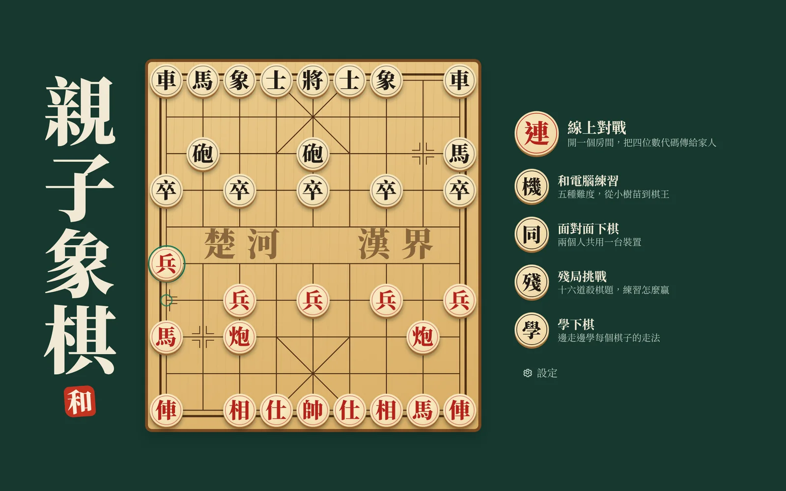
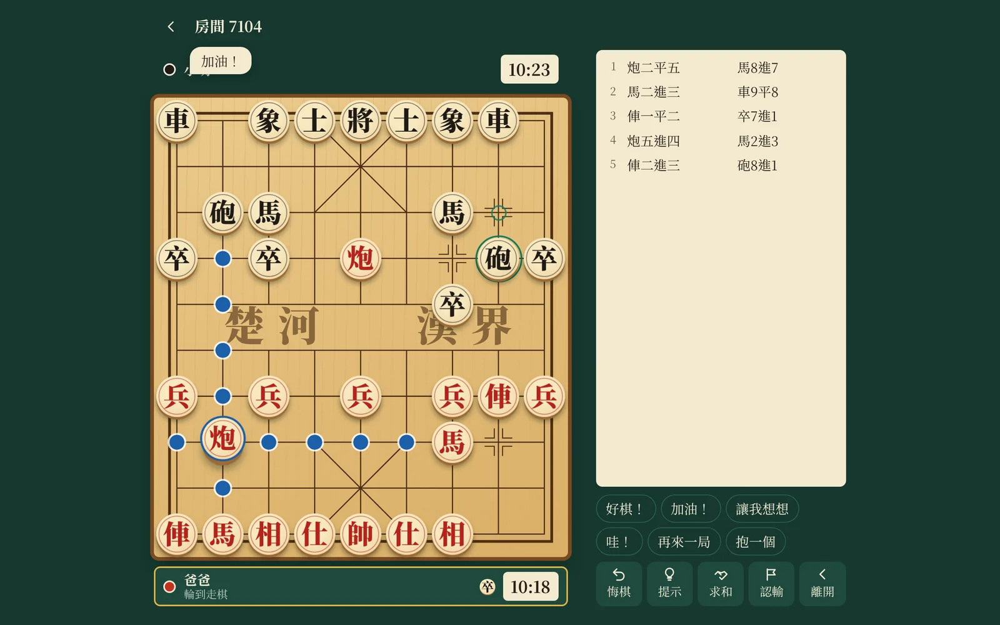
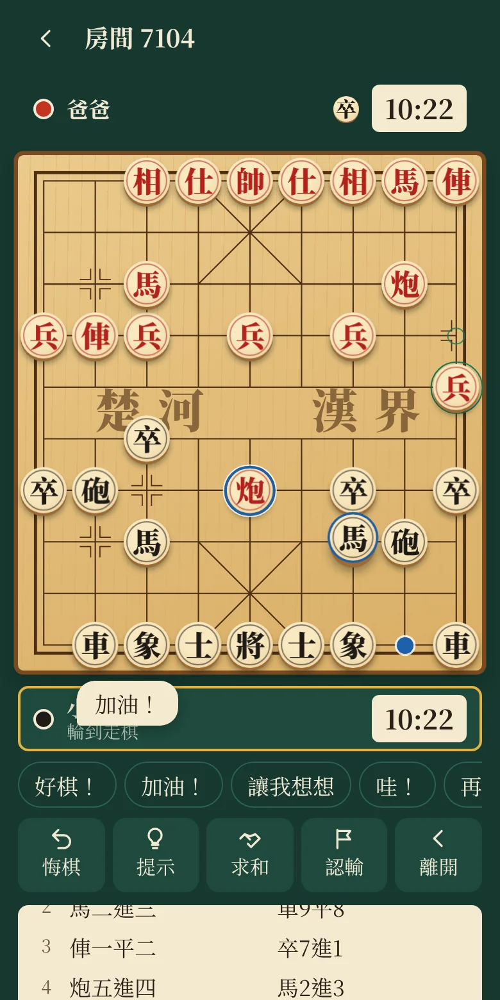
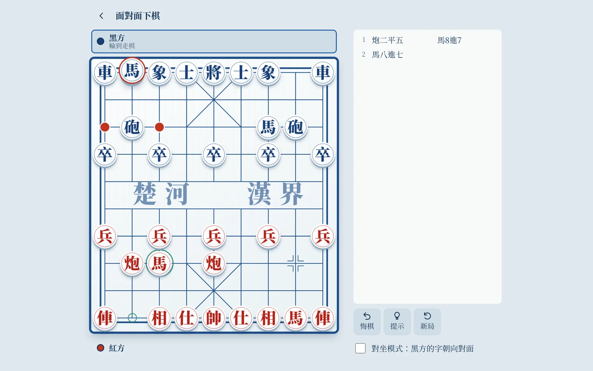
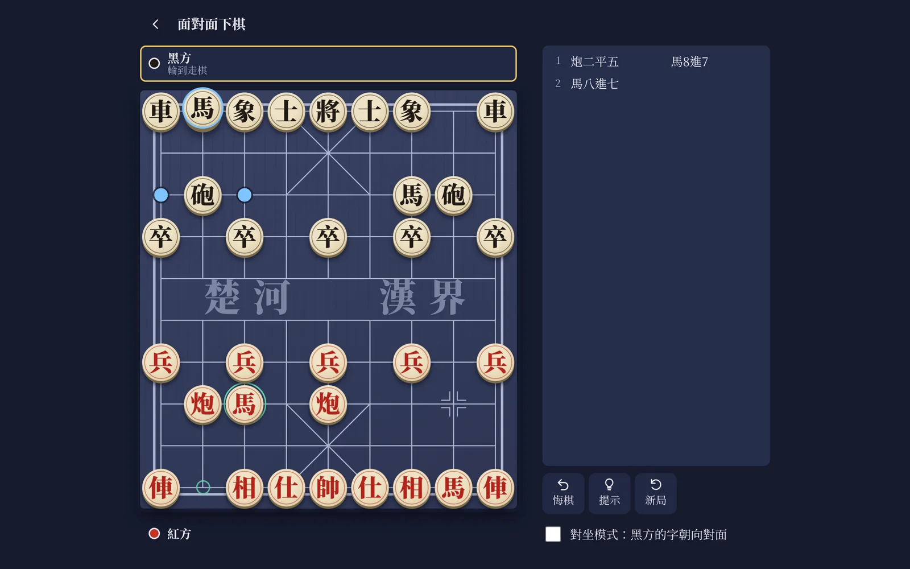
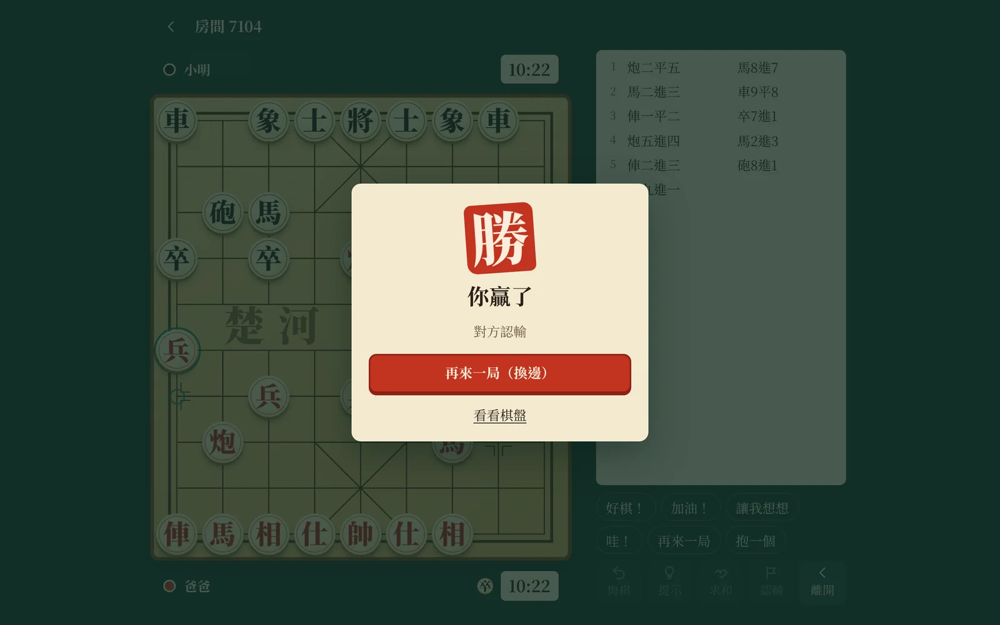

<div align="center">


# 親子象棋

**把四位數代碼傳給家人，就能隔著螢幕下一盤棋。**

也能和電腦練習、解殘局、邊玩邊學每個棋子的走法。打開網頁就能玩，不用安裝。



</div>

## 可以玩什麼

| 模式       | 內容                                                                       |
| ---------- | -------------------------------------------------------------------------- |
| 線上對戰   | 建立房間後分享代碼或連結。可設定棋鐘、讓子、選邊，也能讓親友進來觀戰。     |
| 和電腦練習 | 五種難度，從常常漏看的「小樹苗」到全力思考的「棋王」，可以悔棋、看提示。   |
| 面對面下棋 | 兩個人共用一台裝置。平板放在中間時，對坐模式會把黑方的字轉向對面。         |
| 殘局挑戰   | 十六道一到三步殺，包含馬後炮、重炮、雙車錯等經典殺法，答錯會退回讓你再想。 |
| 學下棋     | 十二堂互動課程，涵蓋七種棋子，以及蹩馬腿、塞象眼、王不見王等規則。         |
| 我的棋譜   | 自動保存最近五十盤棋，可以逐步回看、賽後分析，或複製中文棋譜。             |

<table>
  <tr>
    <td width="68%"></td>
    <td width="32%"></td>
  </tr>
</table>

### 專為親子設計的細節

- **讓子開局**：家長可以讓車、讓馬，孩子一開始就有機會贏。
- **悔棋要對方同意**：線上對局由對方決定，也是練習禮貌的機會。
- **只有預設訊息**：沒有自由輸入的聊天室，只能傳「好棋！」「加油！」這類短句。
- **斷線不會輸**：手機休眠或網路中斷時，座位會保留，棋鐘同步暫停，回來就能接著下。
- **結束時蓋一枚朱印**：贏的時候看得到，輸的時候也好看。

<table>
  <tr>
    <td width="33%"></td>
    <td width="33%"></td>
    <td width="33%"></td>
  </tr>
</table>

### 其他特色

- 內建松林、青花、夜弈三種主題
- 可安裝到主畫面（PWA），離線時仍能和電腦下棋、解殘局
- 支援鍵盤操作：方向鍵移動，Enter 選子與落子，Esc 取消
- 音效全部即時合成，棋子字形內嵌在程式裡，換裝置也不會跑版

## 快速開始

需要 Node.js 22 或更新版本。

```bash
npm install
npm run dev
```

打開 <http://localhost:3000>。修改前端後頁面會自動重新整理，修改伺服器後會自動重啟。

正式環境：

```bash
npm run build
npm start
```

### 常用指令

| 指令               | 用途                                   |
| ------------------ | -------------------------------------- |
| `npm run dev`      | 啟動開發模式                           |
| `npm run build`    | 建置前端與伺服器到 `dist/`             |
| `npm start`        | 執行建置好的伺服器                     |
| `npm test`         | 執行單元與整合測試                     |
| `npm run test:e2e` | 用真實瀏覽器跑完整流程（需先 `build`） |
| `npm run lint`     | 檢查型別與格式                         |
| `npm run format`   | 自動排版                               |

第一次跑端對端測試前，請先執行 `npx playwright install chromium`。

## 部署

任何能執行 Node.js 並支援 WebSocket 的平台都可以部署。專案附有 Dockerfile：

```bash
docker build -t family-xiangqi .
docker run -p 3000:3000 -e TRUST_PROXY=0 family-xiangqi
```

### 環境變數

| 變數                    | 預設值 | 說明                                                   |
| ----------------------- | ------ | ------------------------------------------------------ |
| `PORT`                  | `3000` | 監聽的連接埠                                           |
| `TRUST_PROXY`           | `0`    | 放在反向代理或雲端平台後面時**務必設為 `1`**           |
| `ALLOWED_ORIGINS`       | 空     | 允許連線的其他網域，以逗號分隔；前後端同網域時不需設定 |
| `MAX_ROOMS`             | `2000` | 同時存在的房間上限                                     |
| `ROOM_IDLE_TTL_MINUTES` | `30`   | 房間沒有人之後保留的分鐘數                             |

> [!IMPORTANT]
> 在 Cloud Run、Render、Nginx 這類環境，伺服器看到的連線來源都是代理本身。
> 如果沒有設定 `TRUST_PROXY=1`，所有玩家會共用同一份限流額度，建房與加入可能被擋下。

健康檢查路徑是 `GET /healthz`。

## 規則

遵循中國象棋的基本規則，以下幾點容易和其他軟體不同：

- **困斃判負**：輪到自己卻無棋可走就輸了，即使沒有被將軍。
- **長將判負**：同一局面出現三次時，若循環中只有一方每步都在將軍，該方判負。
- **長捉判負**：同一局面出現三次時，若只有一方每步都在將軍或捉子，且至少捉了一次，該方判負。捉子是指車馬炮新攻擊到對方吃了也不會被吃回的棋子；將帥與兵卒不算被捉。
- **重複局面判和**：其他情況下，同一局面第三次出現即為和棋。
- **自然限著**：連續 60 回合沒有吃子判和。
- **子力不足**：雙方都只剩將、士、象時判和。

目前的判定是簡化版本，沒有處理長攔等正式比賽的細則。

## 專案結構

```text
src/
├── engine/    純 TypeScript 的象棋引擎，前後端共用
│   └── ai/    評估函式、Alpha-Beta 搜尋、難度設定、殘局求解器
├── shared/    前後端共用的協定常數與型別
├── server/    HTTP、WebSocket 閘道與房間邏輯
└── client/    React 介面
tests/
├── engine/    走法、規則、記譜、AI、殘局題庫
├── server/    房間邏輯與真實 WebSocket 連線
├── client/    前端純邏輯
└── e2e/       Playwright 瀏覽器流程
```

線上對局的所有狀態都在伺服器：用戶端只送出「我想走這步」，由伺服器驗證規則、回合與棋鐘後再廣播。
想了解資料流程、通訊協定，或要新增殘局與主題，請看[架構說明](docs/ARCHITECTURE.md)。

## 已知限制

- 房間存在伺服器記憶體中，重新部署時進行中的線上對局會消失；已結束的對局保存在玩家自己的瀏覽器。
- 只能執行單一伺服器實例，要水平擴充需要先把房間狀態移到共用儲存。
- 線上「提示」由玩家自己的裝置計算，建房時可以關閉，但這是約定而不是防作弊機制。
- 介面文字目前只有繁體中文。

## 授權

本專案的程式碼未採用開源授權，著作權由作者保留。使用的第三方素材請見 [THIRD_PARTY_NOTICES.md](THIRD_PARTY_NOTICES.md)，版本變更請見 [CHANGELOG.md](CHANGELOG.md)。
