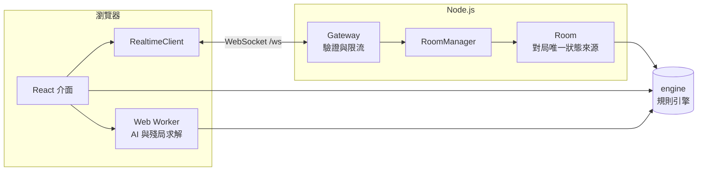
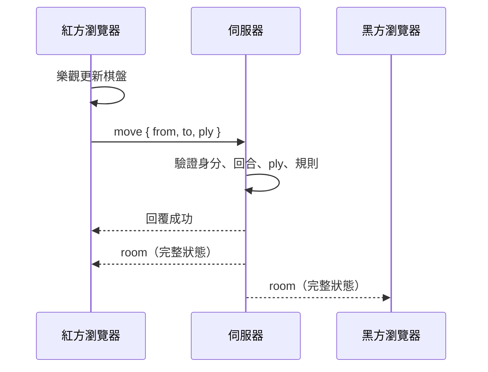

# 架構說明

## 分層

依賴方向只有一個：`client` 和 `server` 可以使用 `engine` 與 `shared`，反過來不行。
`engine` 不依賴 DOM、Node.js 或任何套件，所以可以同時在瀏覽器、Worker 和伺服器執行。

## 引擎

- 棋盤是長度 90 的 `Int8Array`，`square = y * 9 + x`。黑方在上（y = 0），紅方在下。
- 棋子是帶正負號的整數：正數為紅、負數為黑，絕對值代表種類。
- `moves.ts` 用查表產生走法，並把走法編碼成整數，這是 AI 的效能基礎。
- `game.ts` 的 `Game` 是不可變物件，每次走子都回傳新物件，也負責判定終局。
- 把兩將照面視為「被將軍」，王不見王就自然成為合法性檢查的一部分。

開局 perft 的結果與公認數值一致（44、1,920、79,666、3,290,240），由 `tests/engine/moves.test.ts` 保護。

## 線上對戰流程

- **完整狀態廣播**：每次變化都送出起始局面與全部走法，用戶端重播後得到棋局。封包很小，也不會累積不同步。
- **`ply` 檢查**：走法附上用戶端看到的步數，避免依據舊局面下棋。
- **失敗回滾**：伺服器拒絕時，用戶端丟棄樂觀更新，回到伺服器狀態。

### 座位與重連

加入房間時伺服器會發一組隨機 token，存在瀏覽器的 localStorage。斷線時座位保留，只有帶著相同 token 才能回到座位，因此別人無法搶位子。同一座位開第二條連線時，舊連線會被取代。

### 房間生命週期

房間沒有任何連線且超過 `ROOM_IDLE_TTL_MINUTES` 才會回收。`Gateway` 每 500 毫秒執行一次 `sweep`，同時檢查棋鐘是否超時。

`Room` 不碰網路，時間、亂數與 token 都由外部注入，所以棋鐘等邏輯可以用假時鐘測試。

### 通訊協定

用戶端送出 `{ id, type, payload }`，伺服器回覆 `{ kind: 'reply', id, ok, ... }`。型別定義在 `src/shared/protocol.ts`，執行期驗證在 `src/server/schemas.ts`。新增請求時兩邊都要更新。

| 請求                                   | 用途                 |
| -------------------------------------- | -------------------- |
| `createRoom`、`joinRoom`、`leaveRoom`  | 建立、加入與離開房間 |
| `move`、`resign`                       | 走棋與認輸           |
| `propose`、`respond`、`cancelProposal` | 悔棋、求和與重賽協商 |
| `react`                                | 傳送預設短句         |

| 伺服器事件 | 用途                         |
| ---------- | ---------------------------- |
| `room`     | 房間完整狀態                 |
| `reaction` | 對方傳來的短句               |
| `declined` | 請求被拒絕                   |
| `replaced` | 座位已被其他連線接手         |
| `pulse`    | 心跳，讓用戶端偵測失效的連線 |

### 安全措施

- 所有輸入都經過 zod 驗證，單則訊息上限 2 KB。
- 每條連線、每個來源位址都有權杖桶限流，降低猜房號的效率。
- WebSocket 檢查 Origin，防止跨站劫持。
- 靜態檔案設定 CSP 與 `nosniff`，並阻擋路徑穿越。

## AI

搜尋在 Web Worker 中執行：迭代加深、負極大值 Alpha-Beta、主要變例搜尋、置換表、空著裁剪、殺手與歷史啟發、靜態搜尋。評估函式是子力位置表，隨走子增量更新。

低難度靠三個方式降低棋力：限制深度、在接近最佳分的走法中隨機選擇、偶爾亂走一步。

殘局用的 `solver.ts` 是不做剪枝假設的窮舉，結論可以信任，也因此每道題都能被測試證明。

## 常見修改

**新增殘局**：在 `src/engine/puzzles.ts` 加一筆，執行 `npm test`。測試會證明它確實是 N 步殺，而且不能更快。

**新增主題**：在 `app.css` 新增 `:root[data-theme='...']`，並在 `lib/settings.ts` 的 `THEMES` 登記。

**新增預設短句**：在 `src/shared/protocol.ts` 的 `REACTIONS` 加一筆，驗證會自動跟上。

**更換棋子用字**：修改 `scripts/extract-glyphs.py` 的 `TEXT` 後重新產生 `glyphs.ts`。
